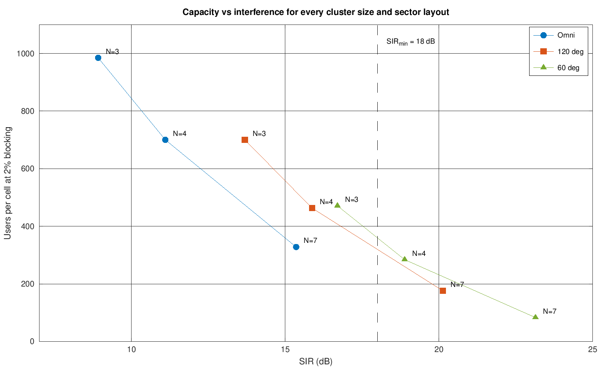
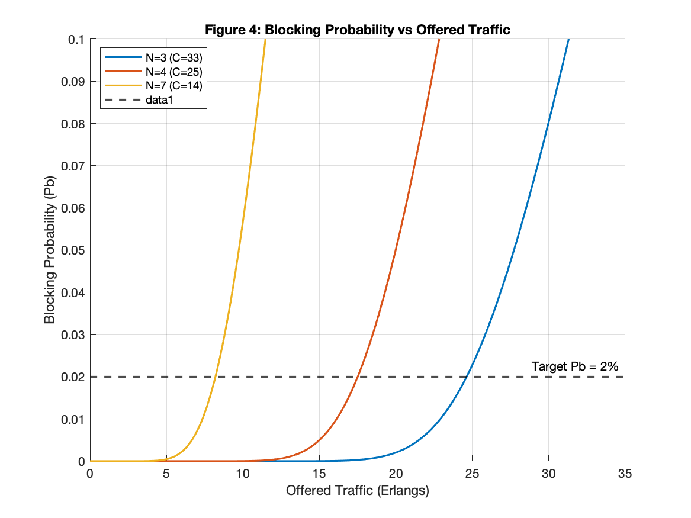
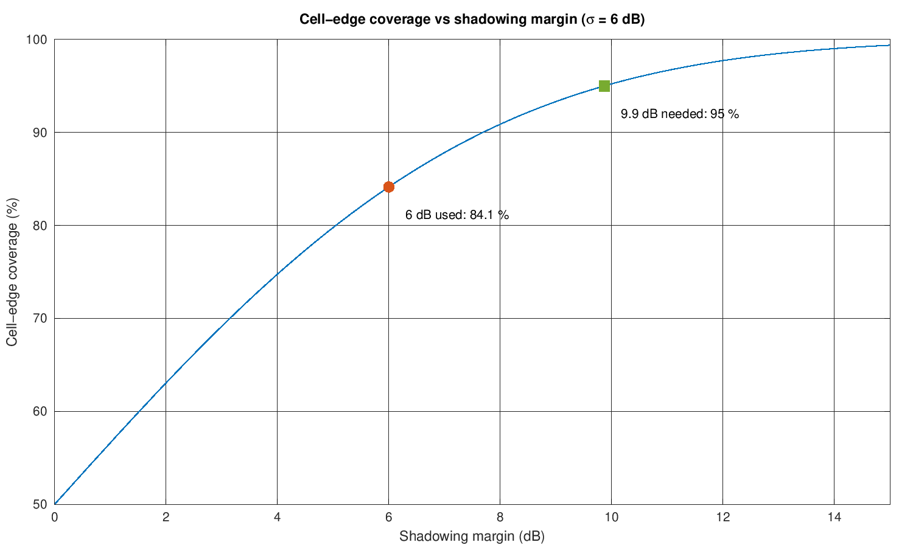

# Cellular Network Design – 2 GHz Urban Macro-Cell (MATLAB)

End-to-end design of a cellular network for a 25 km² dense urban area: frequency reuse, co-channel interference, link budget, noise, Erlang-B capacity, shadowing and fading. A design review then re-checks the result with per-sector capacity and a Monte Carlo QPSK simulation.

**Built:** May 2026 · Wireless Communications course project

<p align="center">
  
  
</p>

## Results

| Metric | Result |
| --- | --- |
| Coverage | 10 cells of 1 km radius for 25 km² |
| Link budget at the 1 km edge | EIRP 55 dBm, path loss 115 dB, received −84 dBm, 16 dB link margin |
| Noise | −114 dBm floor (200 kHz, NF 7 dB), 30 dB SNR at the edge |
| Omni SIR, N = 3 / 4 / 7 | 8.9 / 11.1 / 15.4 dB, all below the 18 dB target |
| Original design | N = 7, 120° sectors: SIR 20.1 dB, **176 users per cell** once channels are split per sector |
| Best design found in review | N = 4, 60° sectors: SIR 18.9 dB, **284 users per cell** (+61 %), 2,840 users over 10 cells |
| Shadowing | 6 dB margin = 84 % cell-edge coverage; 95 % needs 9.9 dB, which still leaves a 12.1 dB link margin |
| QPSK BER, Monte Carlo vs theory | Matches across 0–30 dB Eb/N0 in AWGN and Rayleigh fading (e.g. 2.57 × 10⁻⁴ simulated vs 2.50 × 10⁻⁴ theory at 30 dB, Rayleigh) |

## How it works

**Parameters.** 2 GHz carrier, 20 MHz split into 100 channels of 200 kHz. Log-distance path loss with n = 3.5 and 80 dB at 100 m. Log-normal shadowing σ = 6 dB. 43 dBm transmitter, 15 dBi base-station antenna. Targets: 18 dB SIR and 2 % blocking. Each user offers 0.025 Erlang.

1. **Reuse and interference** (`src/interference.m`). Cluster size N = i² + ij + j², reuse distance D = R√(3N), and SIR ≈ (D/R)ⁿ / i₀, where i₀ is the number of first-tier co-channel interferers: 6 for omni cells, 2 for 120° sectors, 1 for 60° sectors.
2. **Link budget and noise** (`src/link_budget.m`). Pr = Pt + Gt + Gr − losses − PL(d). The noise floor is −174 dBm/Hz + 10 log₁₀B + NF.
3. **Capacity** (`src/capacity.m`). Erlang B gives the traffic each channel pool carries at 2 % blocking; dividing by 0.025 Erlang gives users.
4. **Fading** (`src/fading.m`). Log-normal shadowing around the mean path loss, and a Rayleigh envelope √(I² + Q²) checked against its theoretical PDF.
5. **Link performance** (`src/ber_snr.m`). Theoretical QPSK BER in AWGN and Rayleigh fading.

The design review in `analysis/` builds on these:

- **`design_review.m`** compares omni, 120° and 60° layouts for N = 3, 4, 7. It shares each cell's channels between its sectors and runs Erlang B per sector.
- **`shadowing_coverage.m`** computes the edge coverage a margin really gives, checks it with 10⁶ random draws, and re-runs the link budget with the 95 % margin.
- **`qpsk_ber_montecarlo.m`** simulates the full chain: random bits, Gray-coded QPSK, flat Rayleigh fading, AWGN, coherent detection and bit-error counting. Each point runs up to 2 × 10⁷ bits.

<p align="center">
  
  
</p>
<p align="center">
  
  
</p>
<p align="center">
  
  
</p>

## Engineering notes

These came out of reviewing the original design. The original scripts in `src/` are unchanged; the corrections live in `analysis/`.

- **Sectorization splits the trunk.** Each sector has its own antenna and its own channels, so N = 7 with 120° sectors gives three pools of 5, 5 and 4 channels, not one pool of 14. Small pools trunk badly: 4.41 Erlang per cell instead of 8.2, so **176 users per cell, not 328**. This is the classic trunking-efficiency cost of sectoring.
- **A better design exists.** With 60° sectors, each sector sees one co-channel interferer. N = 4 then reaches 18.9 dB, clearing the target, and carries 284 users per cell, 61 % more than N = 7 with 120° sectors. The catch: only 0.9 dB of SIR headroom, so it depends on the antennas' front-to-back ratio holding up. N = 7 / 120° keeps 2.1 dB.
- **6 dB of shadowing margin is 1σ.** With σ = 6 dB that gives 84 % cell-edge coverage, not 95 %. 95 % needs 1.645σ ≈ 9.9 dB. The design survives the fix: the link margin drops from 16 dB to 12.1 dB.
- **The BER axis is Eb/N0.** The formulas in `ber_snr.m` take energy per bit (Eb/N0), so the original Figure 8's "SNR" axis is really Eb/N0. For QPSK, Es/N0 = Eb/N0 + 3 dB.
- **The system is interference-limited, in numbers.** The edge SNR is 30 dB, but SIR is about 20 dB, so the combined SINR is about 19.6 dB, assuming interference behaves like noise. Without diversity, QPSK in Rayleigh fading at that level still has a BER of about 5 × 10⁻³. That is why the design needs diversity and channel coding, not more power.
- **The Simulink chain is a script.** The source → QPSK → Rayleigh → AWGN → detector → error-count chain (Figure 7) is implemented in `qpsk_ber_montecarlo.m` with base MATLAB only, so it runs without the Communications Toolbox and produces a measured BER curve.

## Repository layout

```
src/
  link_budget.m           EIRP, losses, path loss, received power, noise floor, SNR
  interference.m          reuse distance and omni SIR for N = 3, 4, 7
  capacity.m              Erlang-B capacity per cell (omni)
  fading.m                log-normal shadowing and Rayleigh envelope
  ber_snr.m               theoretical QPSK BER, AWGN vs Rayleigh
analysis/                 added in the 2026 review
  design_review.m         omni / 120° / 60° comparison with per-sector Erlang B
  shadowing_coverage.m    edge coverage vs margin, Monte Carlo check
  qpsk_ber_montecarlo.m   end-to-end QPSK simulation vs theory
media/                    figures from both
```

## Run it

MATLAB R2016b or newer, no toolboxes. The `analysis/` scripts also run in GNU Octave (move the local functions in `design_review.m` to the top of the file first).

1. Open the `src` or `analysis` folder in MATLAB.
2. Run any script. Results print to the Command Window, and the scripts save their figures as PNG.

`qpsk_ber_montecarlo.m` takes about 20 seconds.

## Challenges and fixes

- **No cluster size passes with omni antennas.** Even N = 7 only reaches 15.4 dB. Sectorization cuts the interferer count instead of growing N, which would cost far more capacity.
- **Capacity vs interference.** Every gain in SIR costs channels per pool. The review plots every option on one chart (users per cell vs SIR) so the trade-off and the best passing design can be read off directly.
- **Trusting the theory curves.** The BER formulas are validated by simulation rather than assumed.

## Limitations and next steps

- The SIR model is first tier only, with equal distances and no shadowing on the interferers. A shadowed SIR distribution would show how often a cell drops below 18 dB.
- Fading is flat and per symbol with perfect channel knowledge; no Doppler, no channel estimation.
- Next: two-branch receive diversity and a simple convolutional code in the Monte Carlo chain, to show how far they pull the Rayleigh curve back toward AWGN.

## Author

**Michel Salame** — [LinkedIn](https://www.linkedin.com/in/michel-salame)