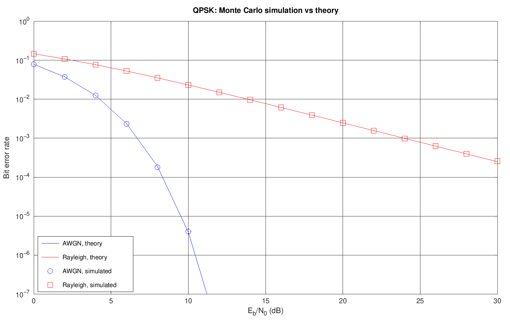
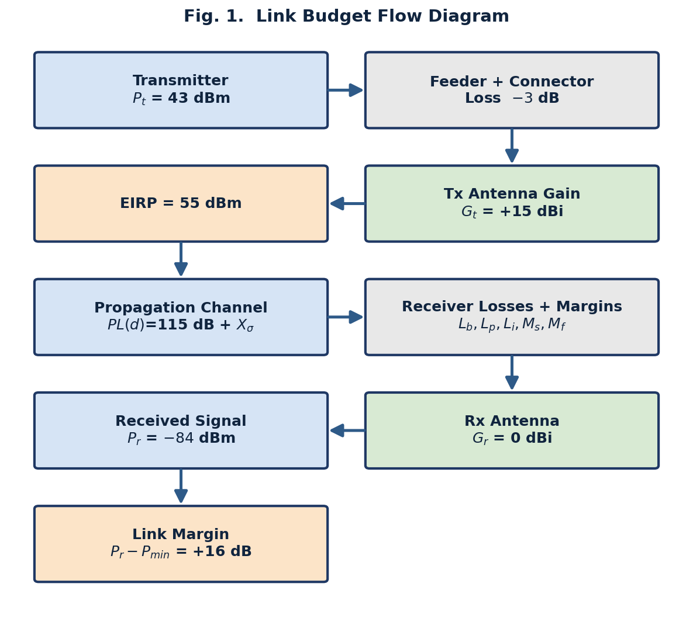
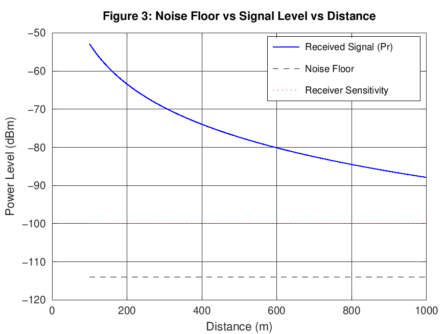
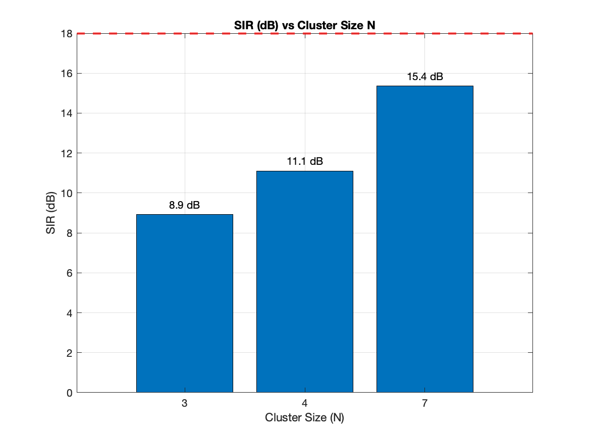
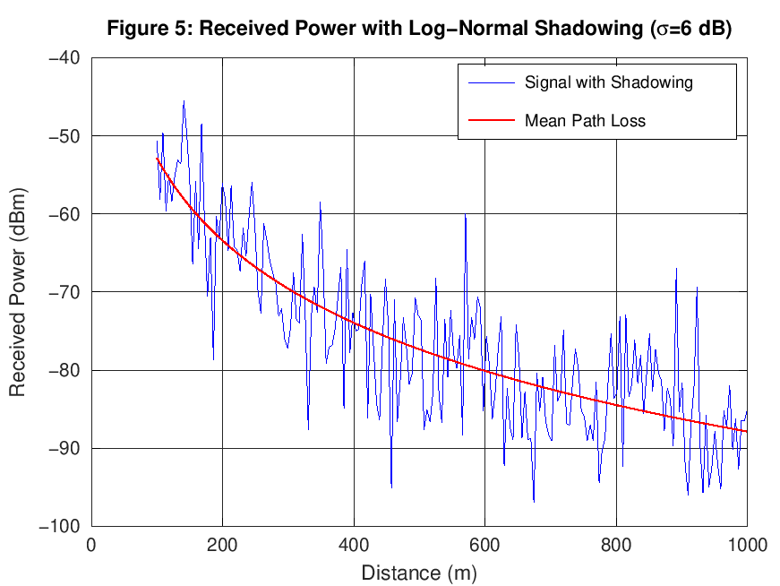
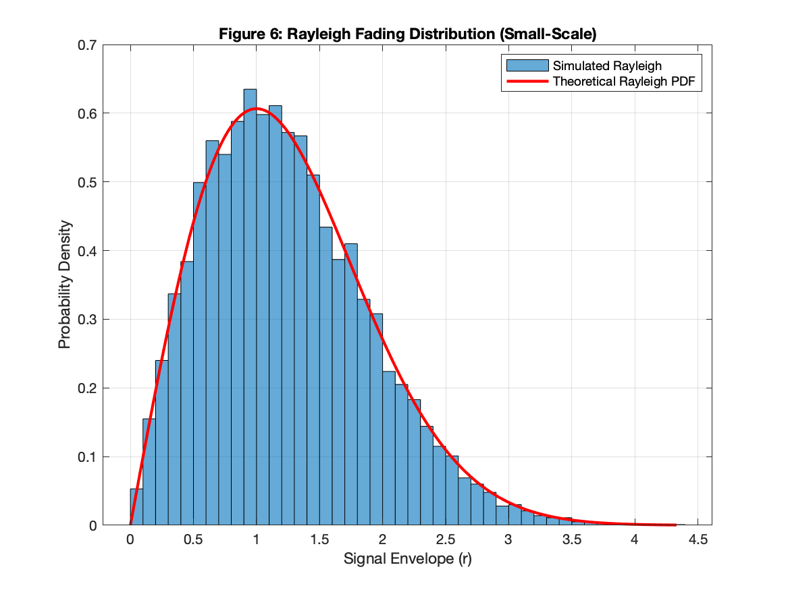

# Cellular Network Design – 2 GHz Urban Macro-Cell (MATLAB)

End-to-end design of a cellular network for a 25 km² dense urban area: frequency reuse, co-channel interference, link budget, noise, Erlang-B capacity per sector, shadowing and fading, with the QPSK link checked by Monte Carlo simulation.

**Built:** May–June 2026 · Wireless Communications course project

<p align="center">
  
  
</p>

## Results

| Metric | Result |
| --- | --- |
| **Final design** | **N = 4 reuse, 60° sectors: SIR 18.9 dB (target 18 dB), 284 users per cell at 2 % blocking** |
| Coverage | 10 cells of 1 km radius for 25 km², 2,840 users in total |
| Link budget at the 1 km edge | EIRP 55 dBm, path loss 115 dB, received −87.9 dBm, 12.1 dB link margin |
| Shadowing margin | 9.87 dB = 1.645σ, for 95 % cell-edge coverage (Monte Carlo: 95.0 %) |
| Noise | −114 dBm floor (200 kHz, NF 7 dB), 26.1 dB SNR at the edge |
| Omni SIR, N = 3 / 4 / 7 | 8.9 / 11.1 / 15.4 dB: no omni layout meets 18 dB |
| Runner-up | N = 7, 120° sectors: SIR 20.1 dB but only 176 users per cell |
| QPSK BER, Monte Carlo vs theory | Matches across 0–30 dB Eb/N0 in AWGN and Rayleigh fading (2.57 × 10⁻⁴ simulated vs 2.50 × 10⁻⁴ theory at 30 dB, Rayleigh) |

## How it works

**Parameters.** 2 GHz carrier, 20 MHz split into 100 channels of 200 kHz. Log-distance path loss with n = 3.5 and 80 dB at 100 m. Log-normal shadowing σ = 6 dB. 43 dBm transmitter, 15 dBi base-station antenna. Targets: 18 dB SIR, 2 % blocking, 95 % edge coverage. Each user offers 0.025 Erlang.

| Script | What it does |
| --- | --- |
| `src/interference.m` | Cluster size N = i² + ij + j², reuse distance D = R√(3N), and omni SIR ≈ (D/R)ⁿ / 6 for N = 3, 4, 7 |
| `src/link_budget.m` | EIRP, all losses and margins (shadowing margin set from the 95 % coverage target), path loss vs distance, received power, noise floor, SNR, link margin |
| `src/coverage.m` | Cell-edge coverage as a function of shadowing margin, with a 10⁶-sample Monte Carlo check |
| `src/capacity.m` | Omni, 120° and 60° layouts for N = 3, 4, 7. Each sector gets its share of the cell's channels and Erlang B runs per sector. Picks the highest-capacity layout that meets 18 dB |
| `src/fading.m` | Log-normal shadowing around the mean path loss, and a Rayleigh envelope √(I² + Q²) checked against its PDF |
| `src/ber_snr.m` | End-to-end QPSK simulation (random bits, Gray-coded QPSK, flat Rayleigh fading, AWGN, coherent detection, error count) against theory |

<p align="center">
  
  
</p>
<p align="center">
  
  
</p>
<p align="center">
  
  
</p>

## Engineering notes

- **Sectoring cuts interference but also splits the trunk.** Each sector has its own antenna and its own channels, so capacity has to be computed per sector. For example, N = 7 with 120° sectors gives three pools of 5, 5 and 4 channels. Small pools trunk badly: 4.41 Erlang per cell instead of 8.2 for one pool of 14.
- **Why N = 4 with 60° sectors wins.** With 60° sectors, each sector sees one co-channel interferer instead of six, so N = 4 reaches 18.9 dB. N = 4 also leaves 25 channels per cell instead of 14, so it carries 61 % more users than N = 7 with 120° sectors. The trade-off is 0.9 dB of SIR headroom, so the antennas' front-to-back ratio matters. N = 7 / 120° is the fallback, with 2.1 dB of headroom.
- **Shadowing margin from the coverage target.** With σ = 6 dB, a 6 dB margin (1σ) only gives 84 % cell-edge coverage. 95 % needs 1.645σ = 9.87 dB, and the link still closes with 12.1 dB to spare.
- **Interference-limited, in numbers.** At the edge, SNR is 26.1 dB but SIR is 18.9 dB, so the combined SINR is about 18.1 dB, assuming interference behaves like noise. That is Eb/N0 ≈ 15.1 dB for QPSK. In Rayleigh fading without diversity, that still gives a BER of about 7.5 × 10⁻³. Diversity and channel coding, not more power, are what improve the link.
- **Eb/N0 vs SNR.** The BER formulas take energy per bit, so the BER plot is against Eb/N0. For QPSK, Es/N0 = Eb/N0 + 3 dB.

## Repository layout

```
src/
  interference.m   reuse distance and omni SIR
  link_budget.m    EIRP, losses, margins, path loss, received power, noise, SNR
  coverage.m       edge coverage vs shadowing margin
  capacity.m       omni / 120° / 60° layouts with per-sector Erlang B
  fading.m         log-normal shadowing and Rayleigh envelope
  ber_snr.m        Monte Carlo QPSK chain vs theory
media/             figures produced by the scripts
```

## Run it

MATLAB R2016b or newer, no toolboxes.

1. Open the `src` folder in MATLAB.
2. Run any script. Results print to the Command Window, and the figures are saved as PNG.

`ber_snr.m` takes about 20 seconds. `capacity.m`, `coverage.m` and `ber_snr.m` also run in GNU Octave (move the local functions in `capacity.m` to the top of the file first).

## Challenges and fixes

- **No cluster size passes with omni antennas.** Even N = 7 only reaches 15.4 dB. Sectorization cuts the interferer count instead of growing N, which would cost far more capacity.
- **Capacity vs interference.** Every gain in SIR costs channels per pool. Plotting every option on one chart (users per cell vs SIR) makes the trade-off visible, and shows the best passing design directly.
- **Trusting the theory curves.** The BER formulas are confirmed by simulating the full QPSK chain bit by bit.

## Limitations and next steps

- The SIR model is first tier only, with equal distances and no shadowing on the interferers. A shadowed SIR distribution would show how often a sector drops below 18 dB.
- Fading is flat and per symbol with perfect channel knowledge; no Doppler, no channel estimation.
- Next: two-branch receive diversity and a convolutional code in the Monte Carlo chain, to show how far they pull the Rayleigh curve back toward AWGN.

## Author

**Michel Salame** — designed the network and wrote the MATLAB analysis and simulations. [LinkedIn](https://www.linkedin.com/in/michel-salame)
